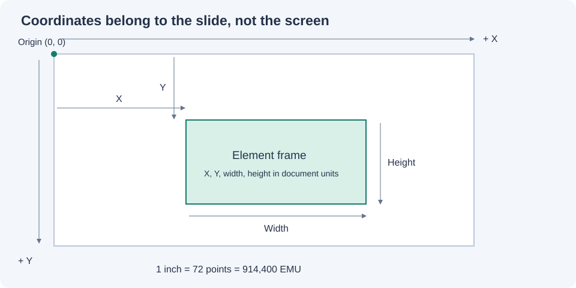

# Slide Coordinate Studio

An offline visual layout editor for PowerPoint automation. Place text, images and shapes on a slide, then copy precise geometry or export a complete script.

**Start:** extract the ZIP and double-click `index.html` in a modern desktop browser. No installation, build, login, internet connection or Microsoft Office is required for the editor. Keep `src/` next to `index.html`.

If your browser restricts local files, open a terminal in this folder:

```sh
python -m http.server 8000 --bind 127.0.0.1
```

Then visit <http://localhost:8000>. On Windows, `py -m http.server 8000 --bind 127.0.0.1` also works; on macOS/Linux use `python3`. The server is optional and serves static files only.

## What is included

- Single-slide canvas with text, rectangle, ellipse and local PNG/JPEG images.
- Drag, four-corner resize, rotation and exact numeric coordinate editing.
- Multi-select, six alignment actions, stacking order, duplicate, lock and hide.
- Configurable grid snapping, zoom, fit view, rulers and out-of-slide warnings.
- Inches, centimetres, millimetres, points and integer EMU coordinate output.
- Change slide dimensions using keep, uniform-fit or stretch policies.
- Copy selected coordinates/code; export full Python or JavaScript scripts.
- JSON save/open with embedded images; best-effort local autosave; bounded undo/redo.
- Runnable examples, automated core tests, optional browser tests and PPTX round-trip tests.
- Documentation, diagrams, MIT license and `.gitignore`.

## A five-minute workflow

1. Open `index.html`. Pick a slide preset and click **Apply slide size**.
2. Add text, shapes or images. Drag them into place. Disable **Snap** for free positioning.
3. Select an element and type its exact X, Y, width and height in the Inspector.
4. Pick **Display units**. This changes the view and JSON coordinates, not the layout.
5. Pick an output format and click **Copy selected**. The output box also supports manual copying.
6. Click **Save JSON** to preserve the complete editable layout.
7. For a complete presentation script, select Python or JavaScript and click **Download full layout code**.

Try **Open JSON** → `examples/demo-layout.json` to load a ready-made layout. Its image is embedded; there are no missing asset paths.

## Generate a PowerPoint file

Python export:

```sh
python -m pip install python-pptx
python examples/demo_export.py
```

JavaScript export:

```sh
npm install --no-save pptxgenjs
node examples/demo_export.cjs
```

Both create `layout.pptx` in the terminal's current directory. Use a separate output directory if an existing `layout.pptx` needs to be preserved. Neither library is bundled in the ZIP or needed by the editor; dependency installation requires network access.

You can also export a saved layout without opening the UI:

```sh
node examples/export-layout.cjs examples/demo-layout.json python output.py
node examples/export-layout.cjs examples/demo-layout.json js output.cjs
```

This CLI refuses to overwrite an existing script. The exporters create a new, single-slide presentation. They do not edit an existing `.pptx`.

## Coordinates



The origin is the top-left of the slide. X increases to the right; Y increases downwards. The model stores inches. Screen pixels, browser zoom, display scaling and device pixel ratio are never exported as slide coordinates.

| Unit | Units per inch | Primary use |
| --- | ---: | --- |
| Inches | 1 | Internal model, `python-pptx` via `Inches`, PptxGenJS |
| Centimetres | 2.54 | Human measurements |
| Millimetres | 25.4 | Human measurements |
| Points | 72 | PowerPoint VBA and shape positioning APIs |
| EMU | 914400 | Office Open XML and exact integer file coordinates |

Font size always uses points. An object's X/Y/width/height describe its **unrotated frame**; rotation happens around the centre. The rotated visible bounds are calculated separately for alignment and boundary warnings.

PowerPoint, Word and Excel share measurement units, but they do not share a universal coordinate origin. Word floating objects can be anchored to a page, margin or paragraph; Excel objects are positioned relative to the worksheet and may be anchored to cells. This tool models a PowerPoint slide. See [coordinate details](docs/COORDINATES.md) before adapting an export to another Office app.

## Documentation

- [User guide and shortcuts](docs/USER_GUIDE.md)
- [Coordinate math and Office integration](docs/COORDINATES.md)
- [Architecture and data contract](docs/ARCHITECTURE.md)
- [Edge cases, limits and troubleshooting](docs/EDGE_CASES.md)
- [Testing and verification results](docs/TESTING.md)
- [Future improvements](docs/ROADMAP.md)

## Development

The editor uses plain JavaScript, CSS and native DOM/pointer APIs. There are no runtime dependencies or build tools. Node 18+ is only needed for tests and the optional headless export CLI. Python is only needed for optional serving or Python exports.

```sh
node --test tests/core.test.cjs
```

Browser integration tests require Playwright and its browser download:

```sh
npm install --no-save playwright
npx playwright install chromium
node tests/browser.test.cjs
```

PowerPoint export checks:

```sh
python -m pip install python-pptx
python tests/export_roundtrip.py
# Also checks JavaScript; first install pptxgenjs:
python tests/export_roundtrip.py --js
```

The geometry tests and both export round-trips passed in the delivery environment. Browser tests are supplied but could not run here because the Chromium download failed. Font matching, visual PowerPoint rendering and other browsers have not been verified. See `docs/TESTING.md` for the precise validation boundary.

## Scope and tradeoffs

This is a coordinate/layout companion, not a PowerPoint rendering engine. Browser and Office text can wrap differently due to fonts, typography, autofit and platform differences. The exported object frames are precise; pixel-identical text rendering is not promised.

Version 1 intentionally has one slide, plain text, zero text margins, no text autofit and image stretching to the defined frame. There is no PPTX import, chart/table authoring, grouping, image cropping, collaboration or native Office integration. The roadmap explains extensions without presenting them as implemented features.

Layouts stay in your browser or files you download. The application has no network requests, telemetry, CDN dependencies or backend. Imported images are restricted to embedded PNG/JPEG; user text is rendered as text, never HTML. Imported JSON is validated before replacing the current project.

License: [MIT](LICENSE).
