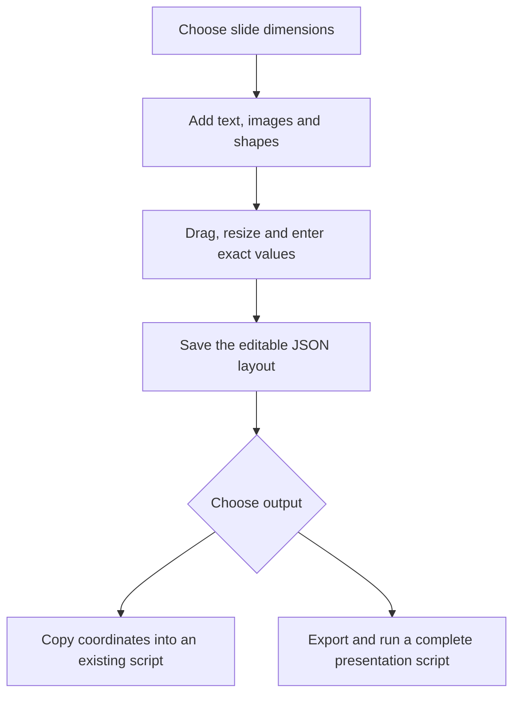

# Slide Coordinate Studio 

**Version:** 1.0  
**Purpose:** Arrange slide elements visually, then use their coordinates in PowerPoint automation scripts.


## Contents

1. [What the tool does](#1-what-the-tool-does)
2. [Requirements and setup](#2-requirements-and-setup)
3. [Understanding the interface](#3-understanding-the-interface)
4. [Create your first layout](#4-create-your-first-layout)
5. [Understand the coordinate system](#5-understand-the-coordinate-system)
6. [Add and edit elements](#6-add-and-edit-elements)
7. [Select, arrange, lock and hide](#7-select-arrange-lock-and-hide)
8. [Grid, snapping, zoom and boundaries](#8-grid-snapping-zoom-and-boundaries)
9. [Change the slide size](#9-change-the-slide-size)
10. [Copy coordinates and export code](#10-copy-coordinates-and-export-code)
11. [Generate a PPTX using Python](#11-generate-a-pptx-using-python)
12. [Generate a PPTX using JavaScript](#12-generate-a-pptx-using-javascript)
13. [Map tool elements to Python objects and dynamic content](#13-map-tool-elements-to-python-objects-and-dynamic-content)
14. [Save, reopen and recover layouts](#14-save-reopen-and-recover-layouts)
15. [Keyboard shortcuts](#15-keyboard-shortcuts)
16. [Troubleshooting](#16-troubleshooting)
17. [Limits and compatibility](#17-limits-and-compatibility)
18. [Files, development and tests](#18-files-development-and-tests)
19. [Recommended working routine](#19-recommended-working-routine)

## 1. What the tool does

Instead of repeatedly changing numeric positions in a Python script, you can place elements on a visual canvas and copy the resulting geometry.

The basic workflow is:



The tool supports:

- Text boxes, PNG/JPEG images, rectangles and ellipses.
- Multiple elements on one slide.
- Exact position, size and rotation editing.
- Layer ordering, multi-selection and alignment.
- Copyable coordinates in inches, centimetres, millimetres, points or EMUs.
- Complete Python and JavaScript presentation scripts.
- VBA coordinate assignments for an existing PowerPoint shape.
- Editable JSON layout files containing text, styles and embedded images.

The browser editor does **not** generate a PPTX directly. It exports a script, which you run with the relevant presentation library. You can also copy coordinates into a script you already have.

## 2. Requirements and setup

### 2.1 Requirements for the editor

You need an extracted copy of the ZIP and a modern desktop browser.

You do not need Python, Node.js, Microsoft Office, an account or an internet connection to use the editor itself.

Chromium-based browsers such as Chrome and Edge, plus Firefox and Safari, are intended targets. Full browser interaction testing was not completed in the delivery environment; see the testing section below.

### 2.2 Open the editor

1. Download `Slide_Coordinate_Studio.zip`.
2. Extract it completely. Do not launch the tool from inside the ZIP viewer.
3. Open the extracted `slide-coordinate-studio` folder.
4. Double-click `index.html`.
5. Keep the `src` folder next to `index.html`; its scripts and stylesheet are required.

You should see the editor with canvas controls on the left, the slide in the middle and the Inspector on the right.

### 2.3 Optional local server

If your browser or company policy blocks local HTML scripts, serve the extracted folder locally.

Open a terminal **inside the `slide-coordinate-studio` folder** and run one of these commands:

**Windows:**

```powershell
py -m http.server 8000 --bind 127.0.0.1
```

**macOS or Linux:**

```sh
python3 -m http.server 8000 --bind 127.0.0.1
```

If your system provides Python as `python`, use that command instead.

Open <http://localhost:8000> in your browser. Keep the terminal running while using this method. Press Ctrl+C in the terminal to stop the server.

If port 8000 is busy, change it to 8001 and open <http://localhost:8001>.

This is an optional static server. The editor still runs in the browser; no Python backend is involved.

## 3. Understanding the interface

| Area | Controls | Purpose |
| --- | --- | --- |
| Header | Undo, Redo, Save JSON, Open JSON, New | History and project management |
| Left: Canvas | Preset, Width, Height, Resize behavior, Apply slide size, Background, Display units | Define the slide and measurement display |
| Left: Add elements | Text, Rectangle, Ellipse, Image | Add slide objects |
| Left: Layers | Front-to-back element list | Select overlapping, hidden or locked objects |
| Middle: Toolbar | Zoom, Grid, Snap, Grid spacing, Keep inside | Control the working view and pointer behavior |
| Middle: Slide | Elements and selection handles | Drag and resize visually |
| Right: Inspector | Name, X, Y, Width, Height, Rotation, text/style settings | Make precise edits |
| Right: Arrange | Alignment, To front, To back, Duplicate, Delete | Organize the selection |
| Right: Copy & export | Format, Copy selected, Download full layout code, output box | Obtain coordinates and scripts |
| Bottom | Status, slide dimensions, element count, warnings | Read operation results and boundary issues |

An Inspector field becomes available when exactly one element is selected. Selecting multiple objects enables group movement and arrangement, but does not provide a shared numeric Inspector.

## 4. Create your first layout

This example creates a simple 16:9 event slide containing a title, subtitle, accent shape and image.

### Step 1: Set the slide

1. Select **Widescreen · 16:9** in Preset.
2. Keep Display units set to **Inches**.
3. Click **Apply slide size**.

The widescreen preset is approximately **13.33333 × 7.5 inches**. The internal preset width is `40/3` inches; the size field displays a rounded value.

### Step 2: Add a title

1. Click **＋ Text**.
2. In the Inspector, set Name to `Slide title`.
3. Enter `Annual Awards 2026` in Text.
4. Set these values:

| Field | Value |
| --- | ---: |
| X · left | 1 |
| Y · top | 0.75 |
| Width | 9 |
| Height | 0.8 |
| Font (pt) | 36 |
| Rotation | 0 |

5. Choose a text colour and use a font installed on your computer, such as `Arial`.
6. Click outside a numeric field after typing to commit the edit.

### Step 3: Add a subtitle

1. Click **＋ Text** again.
2. Set Name to `Subtitle`.
3. Enter your subtitle.
4. Set X to `1`, Y to `1.8`, Width to `9`, Height to `0.5` and Font to `20` points.

### Step 4: Add an accent shape

1. Click **＋ Rectangle**.
2. Set Name to `Accent bar`.
3. Set X to `0.65`, Y to `0.75`, Width to `0.12` and Height to `1.55`.
4. Choose a Shape fill colour.

### Step 5: Add an image

1. Click **＋ Image**.
2. Select a local PNG or JPEG.
3. Enable **Preserve aspect when resizing**.
4. Drag it into position or enter X/Y in the Inspector.
5. Change its width; the height follows its aspect ratio while the option is enabled.

### Step 6: Save and export

1. Click **Save JSON**.
2. Rename the downloaded file to something descriptive, such as `annual-awards-layout.json`.
3. Choose Python or JavaScript under Format.
4. Click **Download full layout code**.
5. Run the downloaded script as described later in this guide.

For a ready-made example, click **Open JSON** and select `examples/demo-layout.json` from the extracted project.

## 5. Understand the coordinate system

### 5.1 Origin and direction

The origin is the **top-left corner of the slide**.

- X increases towards the right.
- Y increases downwards.
- Width and height describe the element's frame.
- Rotation is applied separately around that frame's centre.

An element with `x = 1` and `y = 0.75` begins one inch from the left edge and three-quarters of an inch below the top edge when using inches.

### 5.2 Units

| Unit | Units in one inch | Typical purpose |
| --- | ---: | --- |
| Inches | 1 | Internal layout model and common presentation-library input |
| Centimetres | 2.54 | Human measurements |
| Millimetres | 25.4 | Fine physical measurements |
| Points | 72 | PowerPoint automation coordinate values |
| EMUs | 914400 | Integer coordinates in Office document files |

Font sizes always use points, regardless of Display units.

Changing Display units converts what the UI displays. It does not resize or move elements. Full saved projects always store lengths in inches.

### 5.3 Example conversion

| Measurement | Inches | Points | EMUs |
| --- | ---: | ---: | ---: |
| X | 1 | 72 | 914400 |
| Y | 0.75 | 54 | 685800 |
| Width | 6 | 432 | 5486400 |
| Height | 0.8 | 57.6 | 731520 |

### 5.4 Zoom does not change coordinates

Moving from Fit to 200% enlarges the working view. The element's stored X/Y/width/height remain unchanged.

The 100% view uses 96 CSS pixels per inch as a display convention. It is not a physically calibrated ruler on your monitor. Pixel units are intentionally absent from the export formats.

### 5.5 Rotation and boundaries

X/Y and width/height describe the **unrotated frame**, even if the element is rotated. Positive rotation angles turn clockwise in the screen coordinate system.

The editor calculates rotated visible bounds for alignment and warnings. Those bounds are not substituted for the exported frame coordinates.

The ZIP includes coordinate and rotation diagrams in `docs/coordinates.svg` and `docs/rotation.svg`.

### 5.6 Word and Excel

Word and Excel can use the same measurement units, but require their own position reference settings.

Word objects can be positioned relative to pages, margins or paragraphs. Excel floating objects relate to the worksheet and may interact with cell placement. This tool models a PowerPoint slide; it does not implement Word or Excel anchoring adapters.

## 6. Add and edit elements

### 6.1 Text

Click **＋ Text**, select the element and edit:

| Field | What it changes |
| --- | --- |
| Name | Label in the Layers list; helps identify the object |
| Text | Actual text content; supports plain text and line breaks |
| Font (pt) | Font size in points |
| Font family | A literal installed font family, such as `Arial` |
| Text colour | Colour of the text |
| X/Y/Width/Height | Position and frame dimensions |
| Rotation | Angle around the frame centre |

Text editing takes place in the Inspector, not directly inside the canvas object. Use the textarea for line breaks.

Version 1 does not support rich text, bold/italic controls, text alignment options, bullets or automatic font fitting. Text frames export with zero internal margins.

A larger amount of text does not automatically increase the frame size. Leave enough room and review the generated slide in PowerPoint.

### 6.2 Images

Click **＋ Image** and choose a PNG/JPEG file.

Images are embedded as data in the saved layout and generated scripts. After saving a complete JSON layout, the original image path is not needed to reopen that layout.

Image upload limits:

- File size: at most 10,000,000 bytes.
- Decoded image size: at most 50 megapixels.
- Supported types: PNG and JPEG.

SVG, GIF, WebP and remote image URLs are not accepted. Convert them to PNG/JPEG before adding them.

The tool uses the complete image stretched to its frame. There is no crop, contain/cover, letterboxing or transparency-control interface. Preserve aspect prevents ordinary resizing from changing the ratio; it does not implement cropping.

### 6.3 Shapes

Click **＋ Rectangle** or **＋ Ellipse**.

Shapes use a solid fill with no outline. Change Shape fill in the Inspector. The text and font fields are inactive for shapes.

### 6.4 Resizing

For one unlocked selected element, four corner handles appear.

- Drag a handle to resize.
- Enable Preserve aspect for proportional resizing.
- Hold Shift during a pointer resize to preserve aspect temporarily.
- Type exact width/height values when precision matters.

With Preserve aspect enabled, editing width updates height and editing height updates width. This preference is a UI setting, not a per-element property stored in the JSON project.

### 6.5 Valid numeric ranges

| Property | Supported range |
| --- | --- |
| Slide width/height | 1–56 inches |
| Element width/height | 0.01–112 inches |
| Element X/Y | −112 to +112 inches |
| Rotation | −360 to +360 degrees |
| Font size | 1–1000 points |

The UI displays lengths in the selected unit, but the limits above refer to equivalent inches.

Invalid edits display a status message and retain the previous valid layout. Numeric edits commit when the field changes or loses focus.

## 7. Select, arrange, lock and hide

### 7.1 Selection

Click an element to select it. Click empty slide space to clear the selection.

Shift-click toggles additional objects in the selection. You can also Shift-click entries in Layers.

The Layers list is useful when a front object covers another object. Its top entry is the frontmost element.

### 7.2 Multi-selection

Drag a multi-selection to move its unlocked elements together.

There are no persistent groups. After deselection, the elements remain independent objects. Multi-selection does not enable resizing all selected elements at once.

### 7.3 Alignment

Available actions are Left, Right, Top, Bottom, Centre X and Centre Y.

- With one editable object selected, alignment targets the slide.
- With multiple editable objects selected, alignment targets their combined rotated visible bounds.
- Locked objects are excluded.

For example, select a single title and click Centre X to centre it horizontally on the slide. Select two objects and click Left to align their visible left edges to the leftmost selected edge.

### 7.4 Stacking order

To front moves selected editable objects above other objects. To back moves them behind other objects.

The relative order within the moved set is preserved. Hidden and overlapping objects can still be selected through Layers.

### 7.5 Duplicate and delete

Duplicate copies selected unlocked objects, assigns new IDs and offsets each copy by 0.2 inches in X and Y.

Delete removes selected unlocked objects. A locked object must be unlocked before it can be deleted or duplicated.

### 7.6 Locked versus hidden

| Setting | Canvas visibility | Direct edits | Python/JavaScript export |
| --- | --- | --- | --- |
| Locked | Visible unless also hidden | Disabled until unlocked | Included if visible |
| Hidden | Not drawn | Select through Layers to edit if unlocked | Excluded |

Locks do not prevent project-wide slide scaling or history restoration. Hidden objects remain in Save JSON. Coordinate-only JSON can also include hidden selected objects.

## 8. Grid, snapping, zoom and boundaries

### Grid

Grid displays a visual guide on the canvas. Its spacing is controlled by **Grid (in)**.

### Snap

Snap rounds pointer placement and resizing to the grid increment. Turn it off for free placement.

Grid spacing is always entered in inches, even when Display units uses another unit. The permitted spacing is 0.01–5 inches.

Numeric Inspector edits and keyboard nudges are not snapped.

For multi-selection dragging, the first editable object's X/Y provides the snap anchor; the same movement delta is applied to the others before any boundary constraint.

### Zoom

Fit calculates a view scale from the available workspace. Other options are 50%, 100%, 150% and 200%. At larger zoom levels, scroll the workspace to reach other areas of the slide.

### Keep inside

Keep inside constrains moved or edited objects using their rotated visible bounds.

An object larger than the slide cannot fit without being resized. The editor centres it along the oversized axis and retains a warning.

During group movement, the boundary constraint applies separately to each object. Near slide edges this can change relative spacing. Disable Keep inside when you need the group movement delta to remain identical for every object.

### Warnings

The bottom warning area reports visible elements extending beyond the slide. It does not measure text overflowing its frame or predict Office font wrapping.

## 9. Change the slide size

1. Choose a preset, or select Custom and enter width/height.
2. Choose Resize behavior.
3. Click Apply slide size.

Presets only populate pending values. They do not apply until you press the button. Changing another layout control may refresh those fields from the current slide, so apply pending dimensions first.

| Resize behavior | Effect | Appropriate use |
| --- | --- | --- |
| Keep element dimensions | Slide changes; elements keep their position, dimensions and font size | Add space around an existing composition or rearrange it manually |
| Scale uniformly & centre | Uniformly scales elements/fonts and centres the composition in the new slide | Preserve proportions when the aspect ratio changes |
| Stretch layout to fit | Scales X/width and Y/height separately; font uses the smaller axis scale | Fill a new aspect ratio when distortion is acceptable |

In keep mode, shrinking a slide can leave objects outside its edges. In stretch mode, circles can become ellipses and images can distort.

Scale/fit transforms also affect locked elements. Rotation angles remain unchanged. If a transform produces an unsupported element size or font size, the entire change is rejected.

Use Undo to restore the earlier slide dimensions and layout.

## 10. Copy coordinates and export code

### 10.1 Available formats

| Format | Output | Use |
| --- | --- | --- |
| Coordinates · JSON | Unit-labelled X/Y/width/height, identity and rotation | Feed your existing script or inspect measurements |
| Python · python-pptx | Complete Python presentation code | Create a new PPTX using Python |
| JavaScript · PptxGenJS | Complete CommonJS JavaScript code | Create a new PPTX using Node.js |
| VBA · point coordinates | `.Left`, `.Top`, `.Width`, `.Height`, `.Rotation` assignments | Apply measurements to an existing PowerPoint `shp` variable |

### 10.2 Copy selected

1. Select one or more objects.
2. Choose Format.
3. Review the output box.
4. Click Copy selected.
5. Paste into your editor.

Coordinates JSON uses Display units. Python/JavaScript generation always uses the model's inch geometry; VBA assignments always use points.

Selected Python/JavaScript output includes imports and slide creation, not just coordinate values. It creates a new presentation containing the selected visible objects. If your script already has a presentation and slide, copy only the relevant element-creation statements.

If clipboard access fails, the tool selects the output text. Press Ctrl+C on Windows/Linux or Cmd+C on macOS.

### 10.3 Download full layout code

This button exports the whole layout rather than the selection.

| Format | Download filename |
| --- | --- |
| Coordinates · JSON | `coordinates.json` |
| Python | `layout.py` |
| JavaScript | `layout.cjs` |
| VBA | `coordinates.bas` |

Python/JavaScript exports omit hidden objects. The coordinate/VBA full downloads include all model objects.

Browsers may add a suffix to duplicate download names, for example `layout (1).py`. Use the actual filename when running it, or rename it first.

### 10.4 Save JSON is different

Save JSON produces the **complete editable project**. Coordinate JSON is an array of measurements and cannot be reopened as a full project with Open JSON.

## 11. Generate a PPTX using Python

### 11.1 Install the export dependency

The offline editor does not need this package. Only the generated Python script needs it.

**Windows:**

```powershell
py -m pip install python-pptx
```

**macOS/Linux:**

```sh
python3 -m pip install python-pptx
```

Install with the same Python interpreter you will use to run the script. Package installation needs internet access unless you already have a local installation source.

### 11.2 Export and run

1. Choose Python · python-pptx.
2. Click Download full layout code.
3. Put `layout.py` in a dedicated working folder.
4. Open a terminal in that folder.
5. Run:

```powershell
py layout.py
```

or:

```sh
python3 layout.py
```

The script writes `layout.pptx` in the terminal's **current working directory**, which may differ from the script's directory if you ran it using a longer path.

Open the resulting file in your intended presentation viewer and review the typography and composition.

### 11.3 Change the output filename

At the end of the generated script, replace:

```python
prs.save("layout.pptx")
```

with:

```python
prs.save("annual_awards.pptx")
```

The generated script can overwrite an existing output file. Use a dedicated directory or choose a unique filename.

## 12. Generate a PPTX using JavaScript

### 12.1 Install the export dependency

Install Node.js with npm if it is not already available. Check your installation:

```sh
node --version
npm --version
```

In the folder containing your generated `.cjs` script, install:

```sh
npm install --no-save pptxgenjs
```

### 12.2 Export and run

1. Choose JavaScript · PptxGenJS.
2. Click Download full layout code.
3. Place `layout.cjs` in the folder where Node can resolve `pptxgenjs`.
4. Open a terminal in that folder.
5. Run:

```sh
node layout.cjs
```

The script creates `layout.pptx` in the current working directory.

The `.cjs` extension is intentional: the script uses CommonJS `require`, so it remains usable even within projects configured for ES modules.

### 12.3 Change the output filename

Change the filename in:

```javascript
pptx.writeFile({fileName:'layout.pptx'});
```

The generated file also includes error handling around this call; retain that error handling when editing the filename.

## 13. Map tool elements to Python objects and dynamic content

This section addresses the main automation use case: **your Python script creates the content, and the visual tool supplies where each piece of content belongs**.

### 13.1 Four different names: know what each one means

| Item | Example | Meaning |
| --- | --- | --- |
| Element Name in the tool | `Heading` | A label saved in the layout JSON; use it as your binding key |
| Python variable | `heading_shape` | The Python object returned when your script creates the text box |
| PowerPoint shape name | `Heading` | The name stored inside the generated PowerPoint; you can set it explicitly |
| Source image filename | `Speaker_Name.jpg` | A content source; its filename can also supply the heading text |

These do **not** connect automatically. Your Python code makes the connection by finding the layout element named `Heading`, reading its coordinates, and applying them to `heading_shape`.

Likewise, naming an image in the tool `Main image` does not make Python discover a file with that name. Your script chooses the actual image file and applies the saved `Main image` frame to it.

Use stable, meaningful names rather than relying on array positions such as `elements[0]`. Reordering layers changes array order. Each binding name should identify exactly one layout element.

### 13.2 Create named slots in the visual tool

For the filename-as-heading example:

1. Set your slide dimensions.
2. Add a text element.
3. Change its **Name** to exactly `Heading`.
4. Put placeholder content such as `Speaker Name` in its **Text** field.
5. Position and style it as you want the generated heading to appear.
6. Add any representative PNG/JPEG image.
7. Change that element's **Name** to exactly `Main image`.
8. Position and resize its frame.
9. Keep both elements visible.
10. Click **Save JSON**, then rename the downloaded file to `speaker-layout.json`.

Names are case-sensitive in the sample code: `Heading`, `heading` and `Heading ` are different strings.

The placeholder text and image help you design the layout. The Python script below substitutes the real text and image while retaining the frame positions, dimensions and supported text style.

### 13.3 The binding table

Suppose you chose these coordinates while Display units was Inches:

| Tool element Name | Type | Python object | Content source | X | Y | Width | Height |
| --- | --- | --- | --- | ---: | ---: | ---: | ---: |
| `Heading` | Text | `heading_shape` | Image filename without extension | 1 | 0.6 | 11 | 0.7 |
| `Main image` | Image | `image_shape` | Actual PNG/JPEG file | 3.4 | 1.8 | 6.5 | 4.5 |

These values are examples. Your saved JSON supplies the actual numbers; the script does not need you to hard-code them again.

For `Speaker_Name.jpg`, the script produces:

- Heading text: `Speaker Name`.
- Heading frame: the saved `Heading` X/Y/width/height.
- Image content: the actual bytes of `Speaker_Name.jpg`.
- Image frame: the saved `Main image` X/Y/width/height.

Changing the image filename changes the content. Moving the named elements in the tool and saving the layout changes the geometry.

### 13.4 JSON fields map to Python properties

| Saved layout field | Value meaning | Creating a Python object | Updating an existing object |
| --- | --- | --- | --- |
| `x` | Distance from slide left, in inches | `left=Inches(slot["x"])` | `shape.left = Inches(slot["x"])` |
| `y` | Distance from slide top, in inches | `top=Inches(slot["y"])` | `shape.top = Inches(slot["y"])` |
| `w` | Frame width, in inches | `width=Inches(slot["w"])` | `shape.width = Inches(slot["w"])` |
| `h` | Frame height, in inches | `height=Inches(slot["h"])` | `shape.height = Inches(slot["h"])` |
| `rotation` | Degrees around frame centre | Set after creation | `shape.rotation = slot["rotation"]` |
| `name` | Binding label | Set after creation if useful | `shape.name = slot["name"]` |
| `fontSize` | Points; text only | Apply to paragraphs/runs | `paragraph.font.size = Pt(slot["fontSize"])` |
| `fontFamily` | Font family; text only | Apply to paragraphs/runs | `paragraph.font.name = slot["fontFamily"]` |
| `color` | Text colour, `#RRGGBB` | Apply to text font | Convert with `RGBColor.from_string(slot["color"][1:])` |

Full Save JSON layouts always use inches, even if the Inspector displays centimetres or points. This is why the following code consistently uses `Inches()` for frame geometry and `Pt()` for font size.

### 13.5 A complete runnable example: image filename → heading + image

Save the following as `generate_from_layout.py`. It creates one slide per image. Every slide uses the same named slots from the saved layout.

```python
import argparse
import json
import math
from pathlib import Path

from pptx import Presentation
from pptx.dml.color import RGBColor
from pptx.util import Inches, Pt


def load_layout(path):
    with Path(path).open(encoding="utf-8") as handle:
        layout = json.load(handle)
    if layout.get("version") != 1 or layout.get("unit") != "in":
        raise ValueError("Use a full version-1 Save JSON layout in inches")
    if not isinstance(layout.get("elements"), list):
        raise ValueError("The layout must contain an elements array")
    return layout


def find_slot(layout, name, expected_type):
    matches = [item for item in layout["elements"] if item.get("name") == name]
    if len(matches) != 1:
        raise ValueError(
            f"Expected exactly one element named {name!r}; found {len(matches)}"
        )
    slot = matches[0]
    if slot.get("type") != expected_type:
        raise ValueError(f"{name!r} must have type {expected_type!r}")
    if slot.get("hidden"):
        raise ValueError(f"Unhide {name!r} in the tool and save the layout again")
    for key in ("x", "y", "w", "h", "rotation"):
        value = slot.get(key)
        if isinstance(value, bool) or not isinstance(value, (int, float)):
            raise ValueError(f"{name!r}: {key} must be a number")
        if not math.isfinite(value):
            raise ValueError(f"{name!r}: {key} must be finite")
    if slot["w"] <= 0 or slot["h"] <= 0:
        raise ValueError(f"{name!r} must have positive width and height")
    return slot


def apply_geometry(shape, slot):
    # The tool's inches become python-pptx length values.
    shape.left = Inches(slot["x"])
    shape.top = Inches(slot["y"])
    shape.width = Inches(slot["w"])
    shape.height = Inches(slot["h"])
    shape.rotation = slot["rotation"]
    shape.name = slot["name"]


def add_heading(slide, slot, text):
    heading_shape = slide.shapes.add_textbox(
        Inches(slot["x"]), Inches(slot["y"]),
        Inches(slot["w"]), Inches(slot["h"])
    )
    apply_geometry(heading_shape, slot)
    frame = heading_shape.text_frame
    frame.margin_left = 0
    frame.margin_right = 0
    frame.margin_top = 0
    frame.margin_bottom = 0
    frame.word_wrap = True
    frame.text = text
    for paragraph in frame.paragraphs:
        paragraph.font.size = Pt(slot["fontSize"])
        paragraph.font.name = slot["fontFamily"]
        paragraph.font.color.rgb = RGBColor.from_string(slot["color"][1:])
    return heading_shape


def add_main_image(slide, slot, image_path):
    image_shape = slide.shapes.add_picture(
        str(image_path),
        Inches(slot["x"]), Inches(slot["y"]),
        width=Inches(slot["w"]), height=Inches(slot["h"])
    )
    apply_geometry(image_shape, slot)
    return image_shape


def main():
    parser = argparse.ArgumentParser(
        description="Use named visual layout slots for filename headings and images"
    )
    parser.add_argument("layout", type=Path)
    parser.add_argument("images", type=Path, nargs="+")
    parser.add_argument("--output", type=Path, default=Path("mapped_slides.pptx"))
    args = parser.parse_args()

    layout = load_layout(args.layout)
    heading_slot = find_slot(layout, "Heading", "text")
    image_slot = find_slot(layout, "Main image", "image")

    # Check all input images before creating the presentation.
    for image_path in args.images:
        if not image_path.is_file():
            raise FileNotFoundError(f"Image not found: {image_path}")
        if image_path.suffix.lower() not in {".png", ".jpg", ".jpeg"}:
            raise ValueError(f"Use PNG/JPEG images: {image_path}")

    prs = Presentation()
    prs.slide_width = Inches(layout["slide"]["w"])
    prs.slide_height = Inches(layout["slide"]["h"])

    for image_path in args.images:
        slide = prs.slides.add_slide(prs.slide_layouts[6])
        slide.background.fill.solid()
        slide.background.fill.fore_color.rgb = RGBColor.from_string(
            layout["slide"]["background"][1:]
        )

        # Derive content independently of position.
        heading_text = image_path.stem.replace("_", " ").replace("-", " ")

        # Preserve the two mapped elements' relative stacking order.
        for slot in layout["elements"]:
            if slot["name"] == "Heading":
                add_heading(slide, heading_slot, heading_text)
            elif slot["name"] == "Main image":
                add_main_image(slide, image_slot, image_path)

    prs.save(args.output)
    print(f"Created {len(args.images)} slide(s): {args.output.resolve()}")


if __name__ == "__main__":
    main()
```

Run it on Windows:

```powershell
py -m pip install python-pptx
py generate_from_layout.py speaker-layout.json Speaker_Name.jpg --output speaker.pptx
```

Run it on macOS/Linux:

```sh
python3 -m pip install python-pptx
python3 generate_from_layout.py speaker-layout.json Speaker_Name.jpg --output speaker.pptx
```

For multiple images:

```sh
python generate_from_layout.py speaker-layout.json Speaker_A.jpg Speaker_B.jpg --output speakers.pptx
```

Use `py` or `python3` instead of `python` if that is how Python is installed on your computer. Quote paths containing spaces:

```powershell
py generate_from_layout.py "speaker-layout.json" "images/Speaker Name.jpg" --output "speaker.pptx"
```

The image paths are relative to your terminal's working directory, not automatically relative to the layout file. Absolute paths also work.

This example uses the layout's background and only the two mapped elements. Other layout elements are deliberately ignored. It is a binding example, not a replacement for the tool's complete exporter. To retain all static decorations, add those elements to your script as well, or start from the full exported Python code and replace the heading/image content there.

This example reads trusted projects saved by the editor and performs binding checks; it does not reproduce the editor's complete import validator.

### 13.6 Apply saved geometry to objects your script already creates

If you already create `heading_shape` and `image_shape`, you do not need to recreate them:

```python
layout = load_layout("speaker-layout.json")
heading_slot = find_slot(layout, "Heading", "text")
image_slot = find_slot(layout, "Main image", "image")

# These objects already exist in your script:
# heading_shape = slide.shapes.add_textbox(...)
# image_shape = slide.shapes.add_picture(...)

apply_geometry(heading_shape, heading_slot)
apply_geometry(image_shape, image_slot)

heading_shape.text_frame.text = Path("Speaker_Name.jpg").stem.replace("_", " ")
```

The helper functions come from the complete example above. `apply_geometry()` only updates position, size, rotation and shape name; it does not replace the image bytes or apply text styling.

Setting `text_frame.text` replaces text and can reset run-level formatting. Apply your font/style settings after changing the text, as `add_heading()` does.

For more objects, extend the binding explicitly:

```python
bindings = {
    "Heading": heading_shape,
    "Main image": image_shape,
    "Footer": footer_shape,
}

for layout_name, shape in bindings.items():
    expected_type = "image" if layout_name == "Main image" else "text"
    slot = find_slot(layout, layout_name, expected_type)
    apply_geometry(shape, slot)
```

Here `footer_shape` must already exist, and the tool must contain exactly one text element named `Footer`.

### 13.7 Alternative: edit the complete exported Python script

For a one-off slide, the fastest route is often:

1. Finish the layout in the visual tool.
2. Download the full Python code.
3. Find the heading's text-box block.
4. Replace its fixed text with a filename-derived variable.
5. Find the image's picture block.
6. Replace its embedded image source with your actual file path.
7. Keep the exported position and size arguments unchanged.

For example:

```python
from pathlib import Path

image_path = Path("Speaker_Name.jpg")
heading_text = image_path.stem.replace("_", " ")

# Keep the coordinate values copied from your tool.
heading_shape = slide.shapes.add_textbox(
    Inches(1), Inches(0.6), Inches(11), Inches(0.7)
)
heading_shape.text_frame.text = heading_text

image_shape = slide.shapes.add_picture(
    str(image_path),
    Inches(3.4), Inches(1.8),
    width=Inches(6.5), height=Inches(4.5)
)
```

For that approach, later moving an object in the tool requires copying/exporting the revised coordinates into your script again. The JSON-driven approach automatically reads the latest geometry each time you run it against the saved project.

### 13.8 Coordinate JSON versus full layout JSON

A coordinate-only export looks like:

```json
[
  {
    "id": "title-1",
    "name": "Heading",
    "type": "text",
    "unit": "in",
    "rotation": 0,
    "x": 1,
    "y": 0.6,
    "w": 11,
    "h": 0.7
  }
]
```

It is an array, with a unit on each entry. It does not contain the complete text/style/slide model.

The complete Python example above expects **Save JSON**, with top-level `version`, `unit`, `slide` and `elements`. Do not pass `coordinates.json` to it.

If you write a coordinate-only adapter, check `item["unit"]` before converting values:

| Coordinate export unit | Python length constructor |
| --- | --- |
| `in` | `Inches(value)` |
| `cm` | `Cm(value)` |
| `mm` | `Mm(value)` |
| `pt` | `Pt(value)` |
| `emu` | `Emu(value)` |

Import the needed constructor from `pptx.util`. Font size still uses `Pt()`. Treating an EMU value as inches produces an enormous, incorrect coordinate.

### 13.9 What changes when content changes?

| Change | Geometry | Content |
| --- | --- | --- |
| Change image filename | Same named slots | New image and new filename-derived heading |
| Change heading-generation logic | Same named slots | New heading text |
| Move `Heading` in the tool and Save JSON | New heading X/Y | Same content-generation logic |
| Resize `Main image` in the tool and Save JSON | New image width/height | Same input image file |
| Rename a slot without updating Python | Binding fails clearly | No silent guess |
| Create two elements with the same binding name | Binding fails clearly | No arbitrary selection |

Longer filename headings may need a larger frame or smaller font. Geometry binding does not auto-fit text.

Passing both image width and height makes the output fill the exact saved frame. An image with a different aspect ratio can stretch. The editor's Preserve aspect setting is not a saved per-slot crop/fit rule; matching ratios or implementing your own fit/crop logic is necessary when replacing images of varying proportions.

### 13.10 JavaScript and VBA mappings

For an existing PptxGenJS `slide`, numeric positioning uses inches:

```javascript
slide.addText('Your title', {
  x: 1, y: 0.75, w: 6, h: 0.8,
  fontSize: 36, fontFace: 'Arial', margin: 0, rotate: 0
});
```

The same name-based idea applies: find a layout element by `name`, then pass its `x`, `y`, `w`, `h` to `addText()` or `addImage()`.

VBA coordinate output expects an existing PowerPoint shape variable called `shp` and uses points:

```vb
With shp
    .Left = 72
    .Top = 54
    .Width = 432
    .Height = 57.6
    .Rotation = 0
End With
```

Place these assignments inside your own macro after creating or selecting `shp`. The downloaded coordinate text is not a complete macro by itself.

### 13.11 Headless export of the complete saved project

If you want all saved visible objects exported with their placeholder content, use the included CLI:

```sh
node examples/export-layout.cjs my-layout.json python output.py
node examples/export-layout.cjs my-layout.json js output.cjs
```

Run it from the extracted project folder, adjusting paths as needed. It validates the project and refuses to overwrite an existing output script. Run the generated script separately to create the PPTX.

## 14. Save, reopen and recover layouts

### 14.1 Save JSON

Save JSON downloads `slide-layout.json`, containing:

- Slide dimensions and background.
- All element coordinates, rotations and ordering.
- Text and supported styles.
- Embedded PNG/JPEG images.
- Hidden and locked flags.

Rename the file to identify the project/version. For example:

```text
annual-awards-layout-v01.json
annual-awards-layout-v02.json
```

Saving is a browser download. The app does not automatically update a previously downloaded file on disk.

### 14.2 Open JSON

Click Open JSON and select a full project file. The tool validates the schema, dimensions and embedded image data before replacement.

If there are unsaved edits, the browser may ask before replacing the layout. Invalid files leave your current layout intact and display a status message.

A valid project requires `version: 1` and `unit: "in"`. Unsupported versions are rejected rather than silently migrated.

### 14.3 New

New clears the layout to a blank widescreen slide. If the project contains elements, a confirmation appears. You can undo this while its history entry remains available.

### 14.4 Autosave

Autosave uses browser-local storage. When available, reopening the editor can recover the last saved layout.

It is a convenience, not a portable backup:

- Private browsing and local-file policies may block it.
- Large layouts above roughly four million serialized characters pause autosave.
- A previous smaller autosave may remain when a newer large layout cannot be saved.
- Browser cleanup can delete it.
- Multiple tabs on the same origin share one autosave slot; the last writer wins.
- Moving the extracted folder or changing from `file://` to localhost may use a different storage context.

Save JSON regularly, especially after adding images or before closing the browser.

### 14.5 Undo and redo

The history holds up to 50 snapshots with a retention budget of roughly 20 million serialized characters. A single large snapshot may exceed that budget. Older entries are removed as needed.

History is not saved across sessions. A completed drag creates one history entry. Escape cancels an active gesture and clears selection.

### 14.6 What is not saved in a project

Zoom, grid visibility, snap preference, grid spacing, current selection, display units and Preserve aspect are working-view settings. They are not stored in the version-1 layout file.

## 15. Keyboard shortcuts

| Shortcut | Action |
| --- | --- |
| Arrow keys | Move selected editable objects by 1 point |
| Shift + arrow | Move by 10 points |
| Ctrl/Cmd + Z | Undo |
| Ctrl/Cmd + Shift + Z | Redo |
| Ctrl/Cmd + Y | Redo |
| Ctrl/Cmd + S | Save JSON |
| Ctrl/Cmd + D | Duplicate unlocked selection |
| Ctrl/Cmd + A | Select all visible objects |
| Delete / Backspace | Delete unlocked selection |
| Escape | Cancel active gesture and clear selection |
| Shift-click | Toggle an object in the selection |

Canvas shortcuts are ignored while typing in an input, textarea or select. Click a canvas object or another non-text control before using arrow-key movement.

## 16. Troubleshooting

| Problem | Likely reason | What to do |
| --- | --- | --- |
| Editor opens without styling or controls do not work | ZIP not extracted fully or `src` is missing | Extract all files and keep the folder structure intact |
| Local page is blocked | Browser/company local-file restrictions | Use the optional localhost server |
| Copy button cannot access the clipboard | Clipboard permission or context restriction | Select the output and press Ctrl+C/Cmd+C |
| Image is stretched | Frame ratio changed without aspect preservation | Enable Preserve aspect and restore the ratio, or re-add the image |
| Text wraps differently in PowerPoint | Different font metrics, font installation or renderer behavior | Use matching fonts and adjust the frame after reviewing the PPTX |
| Editing one size changes the other | Preserve aspect is enabled | Disable it for independent width/height edits |
| Object will not move, duplicate or delete | Object is locked | Select it through Layers and clear Locked |
| Object disappeared from the slide or export | Hidden flag is enabled | Select it through Layers and clear Hidden |
| Inspector is inactive | No selection or multiple selected objects | Select exactly one object |
| Preset did not change the slide | Apply slide size was not clicked | Choose the preset and apply it |
| Coordinates array cannot be opened | Coordinate export is not a full project | Use Save JSON for reopenable files |
| Import fails | Wrong version, invalid ranges, duplicate IDs or invalid image data | Read the status message and correct the project format |
| Autosave stops after adding images | Layout exceeds autosave budget or storage quota | Download Save JSON and reduce/compress images if useful |
| Layout recovered an older version | Larger recent layout could not autosave, or another tab overwrote the slot | Open the most recent downloaded project file |
| Python says `No module named pptx` | Dependency not installed for that interpreter | Use that interpreter's `-m pip install python-pptx` |
| Node says it cannot find `pptxgenjs` | Package is not accessible from the script location | Install it in the script's project folder |
| Output PPTX cannot be found | Terminal working directory differs from the script folder | Check the terminal's current directory or use an explicit output path |
| Existing PPTX was replaced | Export script saved to the same output filename | Use unique names or separate working directories |
| Objects extend beyond a resized slide | Keep dimensions mode preserved old geometry | Reposition them or choose uniform-fit scaling |

If a generated script fails, read its terminal error message. The browser editor does not run the script or report its generation errors.

## 17. Limits and compatibility

### 17.1 Implemented limits

| Limit | Value |
| --- | --- |
| Slides per project | 1 |
| Elements per project | 500 maximum |
| JSON import file size | 25,000,000 bytes maximum |
| Normalized serialized model | 25,000,000 characters maximum |
| Uploaded image | 10,000,000 bytes maximum |
| Decoded image | 50 megapixels maximum |
| Internal length unit | Inches |
| Coordinate copy precision | Up to six decimals; integer EMUs |
| Inspector display precision | Up to five decimals |

The size caps are upper bounds, not a performance guarantee on older computers. Repeated images are embedded repeatedly; there is no asset deduplication in version 1.

### 17.2 Rendering limitations

The tool guarantees a defined geometry model, not pixel-identical browser and Microsoft Office text rendering.

Fonts are not embedded. Browser and Office line breaking, glyph metrics, bidirectional text and emoji can differ. Boundary warnings concern object frames, not text overflow.

### 17.3 Features not implemented

- Multiple slides or PPTX import.
- Editing an existing PPTX directly.
- Persistent groups, distribution or marquee selection.
- Rich text, bold/italic controls, charts or tables.
- Image crop, masks or contain/cover modes.
- Native Office add-in integration.
- Word/Excel anchoring adapters.
- Cloud project sync or collaboration.
- Mobile-specific interaction design or multi-touch zoom.

### 17.4 Offline behavior

The editor has no network requests, CDN dependencies, telemetry or backend. It works with files you load locally and files you download.

Installing Python/JavaScript presentation libraries is a separate step and usually needs network access. The generated scripts use embedded image data rather than remote image URLs.

## 18. Files, development and tests

### 18.1 Project files

| Path | Purpose |
| --- | --- |
| `index.html` | Editor entry point |
| `src/app.js` | UI, history, selection, pointer interaction and file handling |
| `src/core.js` | Unit conversion, geometry, validation and code exporters |
| `src/styles.css` | Editor styling |
| `examples/demo-layout.json` | Reopenable sample layout |
| `examples/demo_export.py` | Runnable Python sample |
| `examples/demo_export.cjs` | Runnable JavaScript sample |
| `examples/export-layout.cjs` | Headless layout export CLI |
| `tests/core.test.cjs` | Geometry and validation tests |
| `tests/browser.test.cjs` | Optional browser interaction checks |
| `tests/export_roundtrip.py` | Reopens generated PPTX files and checks geometry/content |
| `docs/` | Architecture, coordinate diagrams, edge cases and testing details |
| `package.json` | Optional development commands |
| `.gitignore` | Ignores dependencies, generated files and local environment files |
| `LICENSE` | MIT license |

### 18.2 Core tests

With Node 18 or newer installed, run from the project folder:

```sh
node --test tests/core.test.cjs
```

### 18.3 Export verification

Install the relevant packages, then run:

```sh
python -m pip install python-pptx
npm install --no-save pptxgenjs
python tests/export_roundtrip.py --js
```

Replace `python` with `py` or `python3` where appropriate. Without `--js`, the check runs only the Python export path.

### 18.4 Browser tests

```sh
npm install --no-save playwright pptxgenjs
npx playwright install chromium
node tests/browser.test.cjs
```

Installing optional npm packages together avoids some npm configurations pruning a previously installed no-save dependency.

### 18.5 Delivery verification status

The seven core test groups passed. Both Python and JavaScript exports passed round-trip checks of slide dimensions, element geometry, rotation, text and hidden-element exclusion. Geometry matched within one EMU.

Full browser integration tests did not run successfully in the delivery environment because Chromium was unavailable and its download failed. Visual comparisons in Microsoft PowerPoint and cross-browser interaction testing also remain unverified.

This distinction matters: the export tests verify file geometry and content, not exact visual rendering in Office.

## 19. Recommended working routine

For repeated presentation automation:

1. Match the editor slide size to the slide size in your script.
2. Add representative text and images.
3. Arrange visually, then refine dimensions numerically.
4. Name elements clearly, such as `Main title`, `Speaker photo` or `Sponsor logo`.
5. Use Preserve aspect for images and leave enough space for text.
6. Save a full JSON layout with a descriptive versioned filename.
7. Copy coordinates into your existing script or export the full presentation code.
8. Generate the PPTX in a dedicated output folder.
9. Review the actual file in the intended presentation viewer.
10. Adjust any font/wrapping differences and save a revised layout.

You can reuse the same layout for different event titles, speaker names or images. Keep the geometry template in JSON and change content in your script when the positions stay the same.
