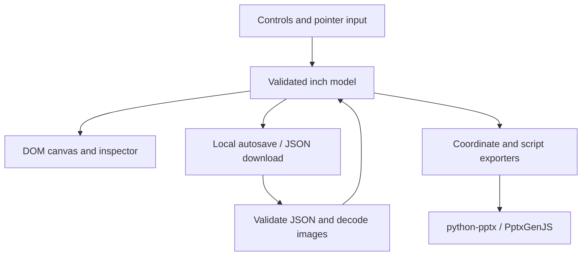
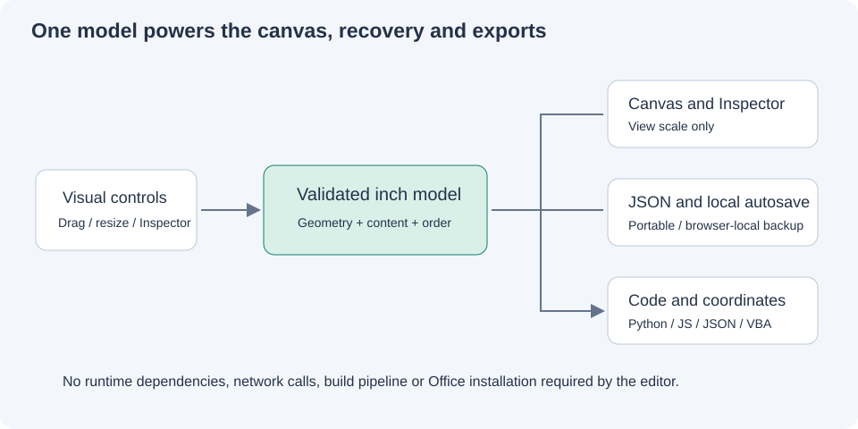

# Architecture and data contract

## Why this stack

Plain HTML/CSS/JavaScript lets the editor run directly from an extracted folder on Windows, macOS and Linux, without Python, Node, Microsoft Office or an internet connection. Classic scripts avoid the module-loading restrictions commonly encountered under `file://`. Pointer events unify mouse, pen and basic touch input. Native text controls and layer buttons supply keyboard alternatives.

A framework, Electron wrapper or Office add-in would add setup and distribution requirements without improving the central coordinate workflow. This does not rule out adding a desktop wrapper later.

Desktop Chromium, Edge, Firefox and Safari are intended targets, but only core/export behavior was verified in this delivery environment. Mobile screens below approximately 805 pixels require horizontal scrolling. Multi-touch gesture zoom and a mobile-specific interface are not implemented.

## Components





`src/core.js` contains unit conversion, rotated bounds, constraints, resizing, validation and code generators. Its small universal wrapper exposes `LayoutCore` in the browser and `module.exports` in Node. The same conversion/export logic is used by UI, CLI and tests.

`src/app.js` owns state, history, selection, pointer gestures, browser IO and rendering. `src/styles.css` handles the shell and visual canvas. `index.html` declares controls and loads the two scripts in order using `defer`.

## Data schema

Every project has `version:1`, `unit:"in"`, one `slide`, and an ordered `elements` array. The first array element is backmost. Selection, view zoom, grid, snapping and inspector aspect preference are UI state; they are not persisted in the project.

```json
{
  "version": 1,
  "unit": "in",
  "slide": {"w": 13.333333333333334, "h": 7.5, "background": "#ffffff"},
  "elements": [{
    "id": "title-1", "type": "text", "name": "Headline",
    "x": 1, "y": 1, "w": 5, "h": 1,
    "rotation": 0, "text": "Hello", "fontSize": 24,
    "fontFamily": "Arial", "fill": "#147c6d", "color": "#243249",
    "locked": false, "hidden": false
  }]
}
```

Image elements additionally require `src`, a PNG/JPEG base64 data URI. Supported types are `text`, `rect`, `ellipse`, `image`. `fontSize`, font and color fields are still required for non-text elements to keep a consistent version-1 contract. They are only applied where relevant.

IDs must be unique strings of at most 100 characters. Validation rejects malformed values and unsupported versions instead of guessing or silently migrating. Unknown top-level/element fields are discarded by the normalizer. Slide fields are explicitly reconstructed.

A coordinate-only JSON download is an array and is **not** a reopenable project. The full Save JSON button produces the versioned schema above. Its units are always inches, regardless of display units.

## Transactions

Ordinary edits snapshot the project, apply the change, validate the entire result and roll back on failure. A completed pointer gesture produces one undo entry. History uses immutable serialized snapshots with count/size limits. Undo/redo restore projects; selection is retained only for IDs that still exist.

File import parses and validates before replacing state, then decodes embedded images in the browser. Save/open and exports use local files. There is no remote upload in the application.

## Export contract

- Python: creates a blank slide at exact custom dimensions, adds visible elements in model order, sets explicit font sizes/colors and zero text margins, embeds images through `BytesIO`, saves `layout.pptx`.
- JavaScript: creates a custom layout, adds visible elements in model order with inch geometry and zero text margins, embeds data URIs, saves `layout.pptx`.
- Coordinate JSON: unit-labelled X/Y/W/H plus identity/type/rotation; exported values are rounded for readability.
- VBA: point geometry applied to an already-defined shape variable `shp`. This is a coordinate adapter, not a full presentation generator.

Text and font names use quoted string serialization. Numeric and color fields are validated; images are embedded instead of interpolating user file paths into scripts. Export routines do not execute the generated code in the browser.

## Extension rules

Keep coordinate operations in `core.js`; never derive document coordinates from rendered bounding boxes. Add a schema version when introducing incompatible project fields. Extend validation and exporters together when introducing a new element type. Require tests for new unit adapters and layout transforms. Do not describe a text renderer as PowerPoint-identical without a rendering comparison in actual Office.
