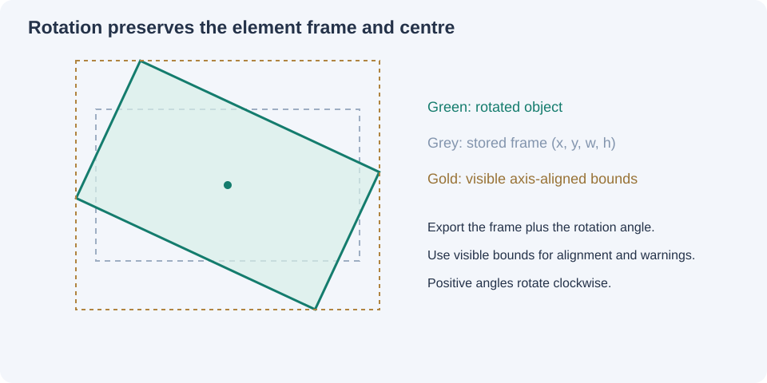

# Coordinate math and Office integration

## Model and viewport

The internal model uses inches. The editor computes a CSS-pixel scale `s` (pixels per inch) for its current viewport. A point in the slide is displayed at `(x*s, y*s)`. A drag changes slide position by `(clientDeltaX/s, clientDeltaY/s)`.

The scale is captured at pointer-down, so a gesture does not depend on subsequent layout calculations. Pointer capture keeps receiving events when the pointer leaves the element. Pointer cancel and Escape restore the pre-gesture snapshot. A lost pointer capture commits the current gesture. Browser/device zoom changes the display, not the model.

Conversions:

```text
inches = value / units_per_inch
output = inches * target_units_per_inch
EMU = round(inches * 914400)
points = inches * 72
```

One point is 12,700 EMUs. Pixel units are deliberately absent: pixels require an explicit DPI assumption and are not a PowerPoint document coordinate system. The 100% view uses 96 CSS pixels per inch for convenience; it is not a guarantee of physical screen size.

### Worked example

| Measurement | Inches | Points | EMU |
| --- | ---: | ---: | ---: |
| Left | 1.25 | 90 | 1143000 |
| Top | 0.5 | 36 | 457200 |
| Width | 4 | 288 | 3657600 |
| Height | 2 | 144 | 1828800 |

```python
shape = slide.shapes.add_textbox(Inches(1.25), Inches(0.5), Inches(4), Inches(2))
```

```javascript
slide.addText('Hello', {x:1.25, y:0.5, w:4, h:2, margin:0});
```

```vb
With shp
    .Left = 90
    .Top = 36
    .Width = 288
    .Height = 144
End With
```

## Rotation

The model's frame is `(x,y,w,h)`, with centre `(x+w/2,y+h/2)`. Positive angles rotate clockwise on a screen whose Y-axis points down.

The axis-aligned visible bounds have:

```text
visible_width  = abs(cos(angle))*w + abs(sin(angle))*h
visible_height = abs(sin(angle))*w + abs(cos(angle))*h
visible_x = centre_x - visible_width/2
visible_y = centre_y - visible_height/2
```

The exported X/Y always come from the frame, not these computed visible bounds. Rotation is a separate property. This avoids changing placement merely because an object is rotated.



Keep inside constrains rotated bounds, but cannot make an object larger than the slide fit. An oversized object is centred along the affected axis and a warning remains. Text overflow is not included in the geometric bounds; PowerPoint can render text outside the frame.

## PowerPoint vs Word and Excel

| Target | Length representation | Required positional context |
| --- | --- | --- |
| PowerPoint VBA | Points | Slide origin |
| `python-pptx` | Length values stored as EMUs | Slide origin; export wraps inches with `Inches()` |
| PptxGenJS | Numeric inches for shape/image/text geometry | Custom slide layout matching the model |
| PowerPoint JavaScript APIs | Points for relevant shape positioning | Slide origin; API and requirement-set support depend on Office version |
| Word floating shapes | Points in relevant Office APIs; OOXML uses EMUs for drawing geometry | Relative page/margin/paragraph anchors and wrap behavior |
| Word inline pictures | Drawing dimensions, no universal freeform X/Y placement | Text flow; insertion paragraph/run |
| Excel floating shapes | Points in relevant Office APIs | Worksheet origin, cell sizes, hidden rows/columns and placement settings |
| Excel cell values | Row/column indices | Not a slide-coordinate model |

This tool does not implement Word or Excel anchoring, Office.js integration, or live Microsoft-app control. Use the point or EMU output only after selecting the destination's anchor/reference model. Copying a slide's point values into Word without anchor settings is insufficient.

## Official references

- Microsoft PowerPoint [Shape.Left](https://learn.microsoft.com/en-us/office/vba/api/powerpoint.shape.left) and [Shape.Top](https://learn.microsoft.com/en-us/office/vba/api/powerpoint.shape.top).
- Microsoft [Slide.Shapes](https://learn.microsoft.com/en-us/office/vba/api/powerpoint.slide.shapes), including point-coordinate examples.
- `python-pptx` [AutoShapes and length units](https://python-pptx.readthedocs.io/en/latest/user/autoshapes.html) and [utility source](https://python-pptx.readthedocs.io/en/latest/_modules/pptx/util.html).
- PptxGenJS [custom layouts](https://gitbrent.github.io/PptxGenJS/docs/usage-pres-options/) and [position types](https://github.com/gitbrent/PptxGenJS/blob/master/types/index.d.ts).

- Microsoft Word [Shape.Left](https://learn.microsoft.com/en-us/office/vba/api/word.shape.left) and [relative vertical positioning](https://learn.microsoft.com/en-us/office/vba/api/word.shape.relativeverticalposition).
- Microsoft Excel [Shape.Left](https://learn.microsoft.com/en-us/office/vba/api/excel.shape.left).

These sources support the Office unit and anchor distinctions. Word/Excel entries describe integration considerations, not implemented adapters. Library/API capabilities can evolve; verify the target Office version before adding a native adapter.
